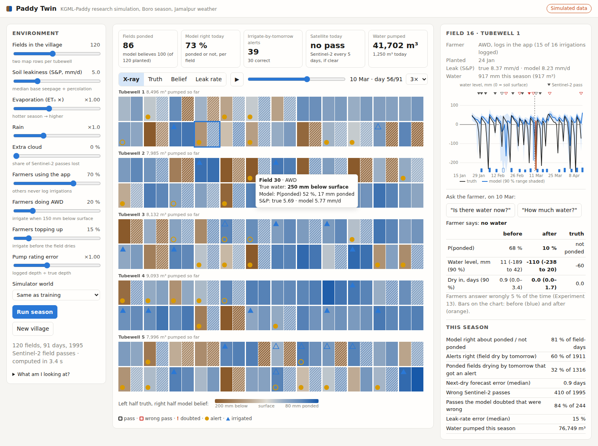
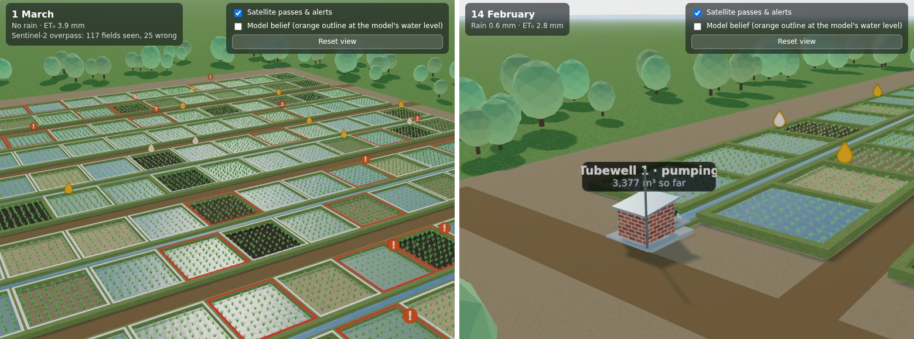

# Paddy Twin

An interactive digital twin of a village of rice fields through one Boro season, built on the research
code. It runs simulator v2 (`awdrt.paddy_sim`) and KGML-Paddy v1b (`awdrt.kgml_paddy`) live. Nothing is
pre-recorded. **Every number is simulation, not field data.**



## Run it

```bash
docker compose up --build        # from the repository root; then open http://localhost:8000
```

Without Docker, from the repository root:

```bash
pip install torch --index-url https://download.pytorch.org/whl/cpu
pip install -r app/requirements.txt
uvicorn app.server:app --port 8000
```

- The image is about 1.6 GB, most of it the PyTorch CPU build.
- A season of 120 fields takes 3–5 s with 2 threads. Set `TORCH_THREADS` in `docker-compose.yml` to
  change the thread count.
- To deploy it, push the image to any container host (a lab server, a small VPS, Hugging Face
  Spaces) and expose port 8000.

## Loading

A season takes a few seconds to compute (about 3 s for 120 fields; longer for large sites, or while an
experiment runs). Meanwhile a card over the map shows the run's real progress. The page polls
`GET /api/progress/<token>` for the token it sent with the run. The stages are:
- in simulation: simulating the season, the model's belief day by day, the next-dry forecasts, true forecasts
  with satellite checks and the crop, then packing;
- in replay: reading the campaign files first, and logger truth with the data QC in place of the true forecasts;
- then receiving the results (in megabytes, as they stream in) and drawing the village.

If another run is still computing, the card says it is waiting for it. If a setting changes during a run, the
newer run's result wins and the older one is dropped.

## 3D village (default view)



A three.js scene built from the same season, meant as a base for later work (real field polygons, loggers,
sensors, other crops). Everything in it is driven by the simulation:

| In the scene | Driven by |
| --- | --- |
| Water in each field | The simulator's water level, eased between days. Heights are exaggerated (water ×12, bunds ×7, rice ×4.5) so a few centimetres show |
| Soil | Wet mud when ponded; darker when just drained; lighter and cracked as the level falls towards −250 mm |
| Rice | Grows as Boro rice does (the crop model below): plant height from the crop's height; hill width from tillers per hill, so seedlings are thin and hills turn bushy through tillering; green deepens with canopy cover; grain heads appear at heading and the crop turns golden as the grain fills; hills sway in the wind |
| Tubewell pump houses, channels, inlets | A command area's channel fills and its pump spouts on days a field there is irrigated; the irrigated field's inlet opens. Signs show the water pumped so far |
| Rain | ERA5 rain of the day (with an overcast sky) |
| Satellite overpasses | NISAR (06:00, L-band SAR, every 12 days), Sentinel-2 (10:30, optical, the real 2023–24 calendar) and Sentinel-1 (18:00, C-band SAR, every 6 days) cross in that order on their days, each under the matching sun (dawn, mid-morning, dusk) with a beam to its swath (SAR looks to the side). Each field seen gets a ring in the sensor's colour (purple, cyan, orange; red if that wet/dry call was wrong); the three rings nest, so a field seen by several sensors on one day shows all of them. The HUD gives counts per sensor, and each sensor can be switched off |
| Sensor accuracy | Sentinel-2 by LAI from the PROSAIL experiment; Sentinel-1 by LAI as measured on real Boro data (about 0.6 under the canopy); NISAR an assumed 0.8 up to 70 cm plant height, falling by 0.15 by 100 cm (no NISAR accuracy over the site yet). As the crop grows, all three see less water (see "Rice growth"). NISAR passes are checked against the water balance (N3) and update the advice as answers (below), but are **not fed to the network**, which was trained without NISAR; Sentinel-1 and -2 are model inputs |
| NISAR answer update | On by default ("Update forecasts with NISAR passes"). The advice shown for day *d* is for the morning of *d* + 1; a NISAR pass at 06:00 that morning re-weights it by Bayes' rule as a yes/no answer with the *assumed* accuracy (Experiment 24, same timing). The sliders set NISAR's simulated accuracy and the accuracy the app assumes separately, to show what a wrong assumption costs. Purple dots on the field chart mark updated mornings; the season summary gives ponded-now accuracy and next-dry error before and after on those mornings; a farmer's answer starts from the NISAR-updated belief |
| Overlays | "!" on passes the model doubts (N3); irrigate-by-tomorrow alerts (filled if right); optional orange outline at the model's believed water level |

Orbit with the mouse, click a field to open it in the field panel, double-click to fly to it. The scene is in
`static/scene3d.js` (`Village3D`: `setData(season)`, `setDay(day)`, `setSelected(field)`); `window.paddyTwin3D`
exposes it for scripted camera tours or screenshots. The 2D views (X-ray, Truth, Belief, Leak rate) remain one
click away, and the page falls back to them if the browser has no WebGL.

three.js r170 (MIT licence, `static/vendor/three/LICENSE`) is served from the app, so the Docker image needs no
internet access.

## Rice growth (the crop model)

The twin grows its rice as transplanted Boro rice grows: in **thermal time** (degree-days above 10 °C from the
run's own daily mean temperature: ERA5 Jamalpur in simulation, the campaign's `tmean_c` in replay). The cold of
January slows the start and March speeds it up (`paddy_sim.crop_state`, Experiment 27):

| Days after transplanting (15 Jan) | 0 | 30 | 45 | 60 | 75 | 90 |
| --- | --- | --- | --- | --- | --- | --- |
| Stage | recovery | tillering | tillering | panicle initiation | booting | booting, near heading |
| LAI | 0.4 | 0.7 | 1.6 | 3.5 | 5.2 | 5.7 |
| Height | 20 cm | 22 cm | 30 cm | 49 cm | 76 cm | 91 cm |
| Tillers per hill | 3 | 7 | 16 | 21 | 19 | 16 |

After heading, LAI falls by 40 % to maturity. Each field's growth factor (0.8–1.2) scales its thermal time, and a
field transplanted later is younger on the same day.

The crop drives everything else in the twin:
- evaporation (Kc follows LAI);
- the model's LAI input;
- the satellites: Sentinel-2's recall falls from 0.99 below LAI 1 to 0.23 at LAI 3.5, Sentinel-1's accuracy
  drops under the canopy, and NISAR loses accuracy above 70 cm;
- the 3D plants.

The field panel shows the crop on the selected day (days after transplanting, stage, LAI, height, tillers,
canopy cover) and how often each satellite sees standing water under it.

Experiments 1–26 used a straight line instead (LAI 0.5 at transplanting, +0.0375 a day). The canopy then closed
too late, and the satellites saw water under the crop for too long. That line is still the simulator's default,
so those experiments reproduce; the app switches to the crop model at start-up. The default model is **v1d**,
pre-trained exactly as v1b but on the new crop (Experiment 27). v1b and v1c, trained on the straight-line crop,
can still be chosen.

## Replay mode (campaign data)

**Data source** switches the app from the simulator to a campaign in `app/campaigns/<name>/`. The model,
forecasts, NISAR answer update, 3D village and 2D map all run on the campaign's observations, and the
**loggers are the only truth**:
- the X-ray left half and the 3D water level of a logger field show its logger;
- fields without a logger are hatched in the truth views, and the 3D scene shows the model's estimate for them;
- a satellite pass is marked wrong only where a logger can check it;
- the season summary scores the model against loggers.

The scores against loggers are:
- ponded or not;
- the next-dry forecast against the realised time to dry. This is censored where an irrigation or rain came
  first, since the forecast assumes no irrigation;
- each sensor's wet/dry error and N3's precision;
- the NISAR update before and after;
- each logger field's S&P from its recession days against the model's estimate.

The summary also lists the data notes and shows how many farmers use the app. Asking a farmer is off in
replay, because real answers come from the app log.

### Data QC (quality control)

The **Data QC** tab (replay only) shows what is wrong with the campaign's data, where, and what to do about it.
The checks are in `qc.py`:

| Group | Check | Severity |
| --- | --- | --- |
| Loggers | no readings; stopped (last reading more than 3 days before the season's end) | high |
| | gap of a day or more; impossible reading (outside the pipe's range); stuck (the same reading 8 times, 48 h) | medium |
| | drift: the logger moves steadily away from the model's daily median (see below) | medium |
| | single-reading spikes; late start; satellite calls disagreeing with the logger far more than for others | low |
| Farmers | rises above 40 mm without rain or a logged irrigation that day or the next (at least 3 in a field) | low |
| | stopped logging: no app entry for 14 days while satellites or the logger still see re-wetting | low |
| | never used the app | note |
| Network | no satellite call on any field for 5 days; fewer than 60 % of loggers reporting on a day | low, medium |
| | weekly tubewell meter against the logged irrigations of its fields (logged under 30 % or over 130 %) | low, medium |

**Drift** needs a reference the logger does not feed. The model's belief uses satellites, farmer logs and
weather, never the loggers, so it can serve. For each logger, `qc.hinge_drift` fits logger minus model median
as flat then a straight line, robustly (Huber), over every onset. It flags the best fit when the line is clear
of the noise (|t| ≥ 6) and large in total (≥ 40 mm by the season's end). The model is not the truth, so the
action is a ruler reading at the pipe, not an automatic correction.

The tab shows:
- severity counts;
- a day strip: loggers reporting per day, each sensor's calls, and the high and medium issues (click to go to a
  day);
- the issue table, filterable by "open now", loggers, farmers and network (click a row to open the field on
  the issue's first day);
- one card per logger, with its reading against the model's median and its issues shaded.

The 2D map colours a logger red or amber on days with a high or medium issue. In 3D, a dead logger's LED goes
dark and a faulty one blinks amber, with the issue on its tag.

**Weekly report.** Pick an ISO week and download it as Markdown (`GET /api/qc/<run>/report.md?week=<i>`). It
gives the week's logger uptime, satellite calls, logged irrigations and metered against logged water, the issues
open that week with their actions, and the season so far. `GET /api/qc/<run>/issues.csv` lists every issue.
Replay sees the whole season, so a drift fit uses later days too. A report for a past week can therefore show a
drift that a report written that week could not have seen yet.

On the demo campaign, QC finds its three injected logger faults and flags no other logger:
- L07 stopped on 10 March;
- L12 has a gap from 24 to 29 February;
- L20 drifts +1.2 mm/day (+71 mm in total). The fitted onset is 14 February; the drift was injected from
  24 February at 1.5 mm/day.

It also flags 8 fields with unlogged irrigations, one farmer who stopped logging and a 5-day spell without
satellite data. The thresholds were set on this one synthetic campaign. Re-check them on the first weeks of
real data.

The campaign format is documented in `campaign.py`:

| File | Content |
| --- | --- |
| `campaign.json` | label, site (a file in `app/sites/`), season start and end, `synthetic` flag, source, optional measured NISAR accuracy |
| `fields.csv` | `field_id, transplant_date` |
| `loggers.csv` | `logger_id, time, level_mm` (any interval; snapped to the model's 00/06/12/18 h grid within 3 h) |
| `app_log.csv` | `field_id, date, event` (`irrigated` or `water_gone`), `pump_hours` or `depth_mm` (the SmartSoil export) |
| `satellite.csv` | `date, sensor` (`s2`, `s1` or `nisar`), `field_id, wet`, and `lai` for Sentinel-2 (Layer 1 output per field polygon) |
| `weather.csv` | `date, et0_mm, rain_mm` (ERA5; the season plus 30 days) |
| `tubewells.csv`, `meters.csv` | measured pump discharge (turns pump hours into depth); metered volumes |

Field and logger ids must match the site file. The model has no field attributes yet, so each field starts as
the model's average field.

`demo_synthetic` is a **synthetic** campaign: a simulated season on the example site, written out in this
format by `scripts/make_demo_campaign.py`. It carries injected problems for the checks to find: a logger that
dies, a 6-day gap, a drifting sensor, and farmers who never use the app. The January 2027 data replaces it.

## The farmer's phone

Select a field and switch the detail panel from **Season chart** to **Farmer's phone**. It shows what SmartSoil
would display to that farmer on the evening of the selected day, in English or Bangla:

| Card | What it shows |
| --- | --- |
| The advice for tomorrow | One of: "Irrigate by tomorrow, Sat 17 Feb" (when the field is more likely than not to be dry by then); "No standing water in your field now: irrigate tomorrow morning"; or "No irrigation needed tomorrow: water should last until about Tue 20 Feb", with the 10–90 % range of dates. Each comes with how sure the model is ("87 % sure"), from 400 posterior samples, including the next morning's NISAR pass |
| "How much water is in your field now?" | Shown when the answer could change the advice: the chance of being dry by tomorrow, or of being ponded, is between 20 and 80 % (Experiment 13). Four buttons (none, a little, some, a lot), with the depth each means. The answer you tap updates the advice ("Thank you. The advice is updated."), and the season chart shows it as a before/after pair. In the chart's own ask buttons, the simulator answers |
| A satellite note | When a NISAR pass the next morning saw water or no water in the field |
| Water loss | The field's leak rate (S&P, mm/day) against the village median: check the bunds and puddling at 1.5× or more; water lasts longer at 0.67× or less |
| Tell SmartSoil | "I irrigated today" (with pump hours) and "The water is gone", the two log types. In the twin they are kept on the page only (demo) |

It follows the day slider, so you can step through a season as the farmer would see it. In replay mode the
advice comes from the stored belief, and no question is asked: the farmers' real answers are in the app log.

The phone view is meant for testing the wording and the questions with farmers before the season. The **Bangla
text is a draft** (`TXT.bn` in `static/app.js`) and must be checked by a native speaker first. Noto Sans Bengali
(SIL Open Font License, `static/vendor/fonts/`) is bundled so Bangla shows on computers without a Bengali font.

## Experiment mode (simulation)

One app run is one village: one draw of fields, farmers, weather noise and satellite errors. A number from one
run is an anecdote. **Experiment** (a view, simulation only) runs setting A and setting B on the same villages
(seeds *first seed*, *first seed* + 1, ...), so every difference is paired (`experiment.py`).

You can compare:
- the model: v1b, or v1c with the wider S&P prior (Experiment 22; also selectable in the sidebar);
- the NISAR answer update, on or off;
- the simulator world or the field layout;
- any environment setting: leakiness, ET₀, rain, cloud, farmers using the app, AWD or topping up, pump rating
  error, NISAR accuracy (simulated or assumed), and the number of fields.

All other settings are the sidebar's. Choose 3–20 villages of 36, 60 or 120 fields. The methane comparison
(Experiment 26) can be added, and so can advice against practice (Experiment 25), which is slow.

For each measure the table gives:
- A and B with their 95 % confidence intervals over villages (Student t);
- the paired difference B − A with its interval, starred when it excludes zero and coloured by whether B is
  better;
- how many villages B did better in;
- "same" when the setting does not touch the measure (for example, the NISAR update does not change the water
  used).

Clicking a measure shows each village as a line from A to B. The measures are those of the season summary.
The next-dry error is the mean absolute error rather than the median: forecasts and truth sit on a 0.1-day
grid, so a median moves in steps and hides small paired differences.

Experiments run in the background, one at a time, with progress (`POST /api/experiment`, then
`GET /api/experiment/<id>`). Results export as:
- CSV, one row per village and setting (`/api/experiment/<id>/export.csv`);
- a Markdown summary that states the settings and seeds, so an app figure can be cited and reproduced
  (`export.md`).

Timing: about 1.5 s per season at 36 fields and 3.5 s at 120, so 5 villages × 2 settings of 60 fields take
about 20 s. With advice against practice, it is about 10–20 s more per season.

## Methane

**Methane** (a map view, in both modes) estimates each field's rice methane from its water history, with the IPCC
Tier 1 method (2019 Refinement, `src/awdrt/methane.py`):

    kg CH4/ha/season = 0.85 kg/ha/day (South Asia baseline, 95 % range 0.58-1.26) x SF_w x SF_p x days in season

| Water regime during the season | SF_w (95 % range) | How it is assigned |
| --- | --- | --- |
| Continuously flooded | 1.00 (0.73–1.27) | no drainage period |
| Single drainage | 0.71 (0.53–0.94) | one drainage period |
| Multiple drainage (including AWD) | 0.55 (0.41–0.72) | two or more |
| Irrigated, regime unknown (IPCC aggregated) | 0.60 (0.44–0.78) | the regional default |

A drainage period is at least 2 days (selectable: 1, 2, 3 or 5) without standing water at the end of the day,
after the field was first flooded. A dry spell that runs to the end of the record is the end-of-season drainage
and does not count.

Neither the IPCC nor carbon-credit methodologies built on it fix this length, and it matters. In simulator v2
the level falls from the surface to −15 cm within a day, so AWD dry spells are short; with a 3-day rule many AWD
fields count as continuously flooded.

Other settings:
- SF_p = 1.00: Boro follows the Aman harvest with a dry fallow of under 180 days;
- no organic amendments;
- GWP100 = 27 (AR6, biogenic methane).

The regime comes from four sources, which you can switch between on the map:

| Source | How the regime is read |
| --- | --- |
| True water level (simulation) or the loggers (replay) | The level itself |
| KGML-Paddy's daily belief | Ponded when P(ponded) > 0.5, with the NISAR update |
| Satellite calls only | Each day takes the last Sentinel-2, Sentinel-1 or NISAR call |
| A regional default for every field | The IPCC aggregated factor, continuously flooded, or multiple drainage |

The panel shows:
- the village methane and t CO₂e, with a 95 % range from the IPCC factor ranges (shared by all fields: an
  inventory's error is systematic);
- per hectare, against continuous flooding;
- how often the model and the satellite get the regime right. This is balanced over the true regimes, because
  a source that calls every field "multiple drainage" would otherwise look good. It also shows how many of the
  continuously flooded fields, the highest emitters, each source finds;
- **H5b:** the share of fields the regional default misjudges by at least half the gap between continuous
  flooding and AWD, and its village total.

The map colours each field by kg CH₄/ha and marks continuously flooded fields "CF". Under the model or satellite
sources, fields whose regime differs from the truth get a dashed outline.

The **Advice vs practice** view also reports methane per run: the advice's change in kg CH₄/ha, and in the
number of continuously flooded fields. Experiment 26 (`scripts/26_methane_regimes.py`) gives the numbers over several villages.

## Advice against practice (simulation)

**Advice vs practice** (a map view, simulation only) asks what the advice would change. The season's village is
re-run from transplanting five times (`src/awdrt/counterfactual.py`):

| Run | Who decides when to irrigate |
| --- | --- |
| Farmers' practice | Each farmer by their own rule (simulator v2: conventional, AWD or topping up) |
| KGML-Paddy | Farmers follow the model's advice. Every evening the model sees what this run's fields have shown so far (satellite passes, the farmer's log, "water gone" reports, weather) and forecasts when the water will be gone |
| Regional S&P | The same advice from the model's state, with one regional leak rate for every field |
| ET only | The same advice with evaporation only, as IRAS-like tools |
| Perfect knowledge | The advice from the true water level and the true leak rate: what any forecast could reach |

Everything the policy does not cause is shared by all five runs:
- the fields' physics, the weather and the puddling flood;
- the depth of each field's k-th irrigation;
- cloud and the satellite detectors' noise;
- which irrigations the farmer logs, and the pump rating error.

So the runs differ only in when water is applied, and in what follows from that. The practice run reproduces
the simulator's season: same mean irrigations and water within a few per cent (tested).

**The advice rule** is set in the panel:
- when it is fixed: "irrigate by tomorrow" (when the water is forecast gone within a day), or booked 3 or 5
  days ahead and not revised;
- when to irrigate: when the water is gone, or 1–2 dry days later (an AWD-like rule);
- how sure the forecast must be: a 50 % chance of dry, or a cautious 25 % or 10 %;
- whether SmartSoil asks "how much water is in the field now?" when the answer could change the advice
  (Experiment 13);
- what share of farmers follow it.

**What it shows**, for the advice you pick against the farmers' practice:
- water pumped, and pump hours and cost (the pump discharge and the cost per hour are your own assumptions);
- stress days per field: the end-of-day level 15 cm or more below the surface, a yield-risk proxy;
- irrigations per field, days ponded, and questions per farmer.

The charts are:
- each run's water against stress days;
- the water pumped through the season;
- a table by farmer type;
- for a clicked field, its water level under practice and under the advice.

The map colours each field by the advice's change in water or stress days: brown is drier than practice, blue
wetter. It takes about 10–20 s for 120 fields.

The picture is a trade-off, not a free saving: earlier irrigation means fewer stress days but more water.
Experiment 25 (`scripts/25_advice_counterfactual.py`) gives the numbers over several villages. Every
number is simulation. The practice is the simulator's farmer rules, which are assumptions until the campaign's
control plots measure real practice (RQ5).

## Logger placement planner

**Plan loggers** (a map view, in both modes) helps choose which plots get the campaign's water-level loggers.
It works on the current field layout. Plots are coloured by a stratum. Clicking a plot adds or removes it;
**Lock** keeps a plot in every suggestion, and **Exclude** keeps it out (for example, a farmer who said no on
the day). **Suggest a plan** fills the plan to the chosen size around the locked plots. Plots whose site-file
attribute `consent` is `no` are hatched and never used. The checks are in `planner.py`:

| Check | What it shows |
| --- | --- |
| Enough working loggers | The chance that at least 20 loggers still work at the end of the season, for a chosen failure rate (binomial), and the plan size that makes it 90 % or 95 % likely. Experiment 19 found that the S&P and forecast intervals need about 20 working loggers. |
| Interval coverage | Experiment 19's mean coverage of the 90 % S&P and forecast intervals for the expected number of working loggers, and the level that 1 campaign in 10 falls below |
| Balance | For each stratum: the share of the plan's loggers in each level against the share of plots, and 1 − total variation distance. Strata are tubewell, channel position (head, middle or tail, by thirds along the channel), plot size (thirds) and every site-file attribute with 2–8 values. The plan is compared with 200 random plans of the same size. A level with at least 5 % of the plots and no logger is called out. |
| Adjacent pairs | Disjoint pairs of planned plots that share a bund: their boundaries run within 3.5 m of each other for at least 10 m. These pairs measure water moving between plots. |
| Upkeep | Each plot's distance to the nearest logger; the read-out walk from the nearest road through every pipe and back (nearest neighbour, then 2-opt), at 4 km/h plus 10 minutes per logger |

Each planned pipe sits inside its plot, at least 6 m from every bund where the plot allows, and nearest the
plot's centre.

`suggest` is greedy, then improves the plan by swaps. It maximises 3 × mean balance + 1 × pairs (up to the
target) + 0.5 × spread + 0.25 × road access. On the synthetic example site, a suggested plan of 40 plots:
- is 99 % balanced, better than every one of 200 random plans (median 93 %);
- has 11 adjacent pairs;
- puts the median plot 24 m from a logger;
- makes a 2.8 km read-out round (7.4 h with the read-outs).

The site's current 26 loggers are better balanced than 90 % of random plans, but one of them is in a plot
without consent.

**Exports.**
- **Installation list (.csv):** one row per planned logger in visiting order, with its plot, pipe position
  (lon/lat and local metres), adjacent partner, distance to the road and strata.
- **Site file with the plan (.geojson):** the site file with its loggers replaced by the planned ones. Put it
  in `app/sites/` to run seasons on the plan.

Plot attributes come from the site file: any property of a field feature other than `kind`, `id` and
`tubewell`. `scripts/site_from_survey.py --attributes plots.csv` merges a December survey sheet (`field_id`
plus columns such as soil, smartphone, consent). The example site's soil, smartphone and consent attributes
are **synthetic** (`scripts/make_example_site.py`).

## Real imagery under the 3D village

The 3D village sits on a real Sentinel-2 true-colour image of its surroundings (6 × 6 km, 10 m), from the
2024 Boro season the simulation uses. The image shown is the latest one taken on or before the day on screen, so
the landscape turns from dry fallow (late January) to transplanted (February) to green rice (March–April) as the
season plays.
- A site file's image is centred on the site's own coordinates.
- The generated grid has no place, so the study area's image is placed under it as a backdrop.
- With imagery on, the decorative trees and homesteads around the village are hidden; the image shows the real
  ones.
- The HUD checkbox "Real Sentinel-2 image around the village" switches it off, and the HUD names the image's
  date and source.

The image is real, but the example site's plots are synthetic and do not match it; the HUD says so. Once the
campaign site is surveyed, its plots will lie on their own fields in the image. At 10 m, a 0.1 ha plot is about
ten pixels, so the image is context, not a per-plot check.

Images come from `scripts/fetch_site_imagery.py`. It:
- finds clear Sentinel-2 L2A scenes on Element 84's Earth Search (AWS Open Data, no account needed);
- reads the 10 m true-colour band (TCI);
- reprojects it to the site's local metres (north up);
- writes `app/sites/imagery/<site>/<date>.jpg` and `meta.json`.

About 70 kB per date; six dates per site by default.

```bash
python scripts/fetch_site_imagery.py --site jamalpur_2027    # after converting the survey
python scripts/fetch_site_imagery.py                         # the study area, under the generated grid
```

Contains modified Copernicus Sentinel data 2024.

## Field layouts (sites)

The **Field layout** selector picks the village the season runs on:

- **Generated grid:** square 30 m plots, two rows per tubewell along a channel. The *Fields in the village*
  slider sets its size.
- **A site file** in `app/sites/*.geojson`: field polygons, water-level logger positions, tubewells, channels and
  roads, in WGS84. Fields keep their real shape and area (water volumes use each plot's area). Loggers are drawn
  where they stand, as an AWD pipe with a logger head, and show the simulated logger reading for their field (end
  of day, with the 3 mm sensor noise and the −250…+150 mm pipe range); the field chart plots it as grey dots.

The format is documented in `sites.py`.

**There are no surveyed plots yet.** The plot boundaries and logger positions are recorded during the campaign
(boundaries mapped by 20 December 2026, loggers installed before transplanting).
OpenStreetMap has no field boundaries in the study window (checked October 2026: only buildings, roads and a
river). Until then, `example_irregular` is a **synthetic** layout (134 long, narrow plots of about 0.1 ha
around three tubewells, 26 loggers) made by `scripts/make_example_site.py`; the app labels it "synthetic, not
surveyed".

To add the real site:

```bash
python scripts/site_from_survey.py --name jamalpur_2027 --label "Jamalpur campaign plots" --surveyed \
    --fields survey/plots.kml --loggers survey/loggers.csv --tubewells survey/tubewells.csv [--channels survey/channels.geojson]
```

- `--fields`: GeoJSON or KML polygons, for example a GPS walk of each bund, or boundaries farmers draw in
  SmartSoil.
- `--loggers` and `--tubewells`: CSV files with `id,lat,lon` columns.
- `--attributes` (optional): a CSV with `field_id` and plot attributes (soil, smartphone, consent, ...) for the
  logger placement planner.

The converter checks the polygons and that every logger falls inside a plot, then writes
`app/sites/jamalpur_2027.geojson`. The site appears in the selector on the next page load, and is copied into
the Docker image on the next build.

## What it shows

- **Environment controls** (left panel):
  - number of fields;
  - soil leakiness (median S&P);
  - evaporation (ET₀ ×) and rain;
  - extra cloud (Sentinel-2 passes lost);
  - share of farmers using the app;
  - shares of AWD and top-up farmers;
  - pump-rating error;
  - the simulator world: the training world, random mismatch, or random + systematic
    (Experiments 8–9).
- **Map views:**
  - **Truth**: the simulator's water level.
  - **Belief**: what the model says each evening, using only what it has seen up to that day.
  - **X-ray**: truth and belief split in each field. Stripes mean the model is unsure.
  - **Leak rate**: true and estimated S&P.
- **Markers:**
  - Sentinel-2 passes, with wrong passes dashed in red.
  - Passes the model doubts (N3, Experiment 14) carry a **!**.
  - "Irrigate by tomorrow" alerts: filled when right.
  - Irrigations: hollow when the farmer did not log them.
  - Tubewell command areas show the water pumped so far.
- **Field panel:**
  - The season chart: truth, the belief with its 90 % range, passes and irrigations. Click the chart
    to jump to a day.
  - **Ask the farmer** "is there water now?" or "how much water?". The belief, its range and the
    days-to-dry forecast are updated by Bayes' rule (Experiment 13).
- **Season summary:** wet/dry accuracy, alert precision and recall, next-dry error, wrong and doubted
  passes, leak-rate error and total water.

The model is the default v1b, pre-trained only (no logger fine-tuning). Settings far from the training
world, such as very leaky soils or a hot season, show its extrapolation limits (Experiment 20).

## Layout

| File | Role |
| --- | --- |
| `engine.py` | One season: simulate, run the model causally (one cut per day, batched), forecasts, N3 check, farmer answers |
| `server.py` | FastAPI: `POST /api/season`, `POST /api/replay`, `POST /api/ask` (kind yesno, depth or none; an optional given answer), `GET /api/qc/<run>/report.md`, `GET /api/qc/<run>/issues.csv`, `POST /api/plan/{site,evaluate,suggest,export}`, `POST /api/counterfactual`, `POST /api/methane`, `POST /api/experiment` (+ `GET /api/experiment/<id>[/export.csv|.md]`), `GET /api/defaults`, `GET /api/sites`, `GET /api/campaigns`, static files |
| `sites.py`, `sites/` | Field layouts: the generated grid and GeoJSON site files (format in `sites.py`) |
| `campaign.py`, `campaigns/` | Replay mode: campaign data (format in `campaign.py`) and the synthetic demo campaign |
| `experiment.py` | Experiment mode: paired comparisons over villages, summaries, CSV and Markdown export |
| `qc.py` | Data quality control for campaign data: the checks, the weekly report |
| `planner.py` | Logger placement planner: strata, adjacency, plan checks, suggestions, exports |
| `../src/awdrt/methane.py` | IPCC Tier 1 methane from each field's water regime (engine `run_methane`) |
| `../src/awdrt/counterfactual.py` | Advice against practice: the closed-loop re-runs of a village (engine `run_counterfactual`) |
| `static/` | Single-page front end: `app.js` (controls, 2D map, SVG chart; light and dark themes), `scene3d.js` (3D village), `vendor/three/` (three.js) |
| `Dockerfile` | CPU image; build from the repository root (see `docker-compose.yml`) |

Tests: `python -m pytest tests/test_app.py tests/test_sites.py tests/test_campaign.py tests/test_qc.py tests/test_planner.py tests/test_counterfactual.py tests/test_methane.py` (the app test needs `fastapi` and `httpx`).
